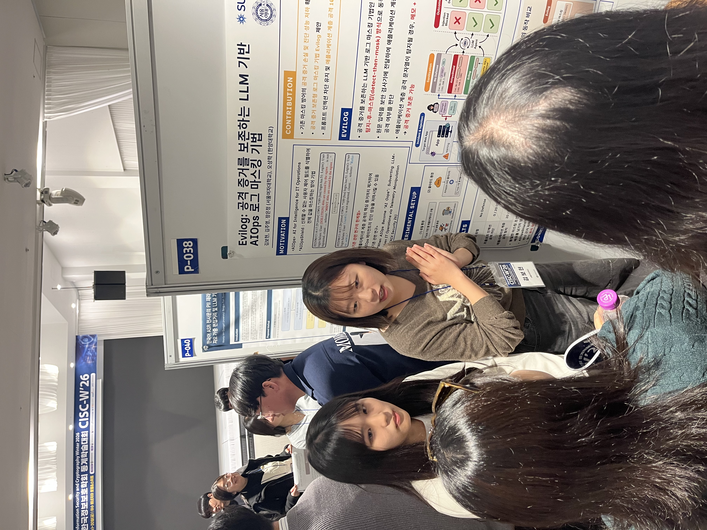
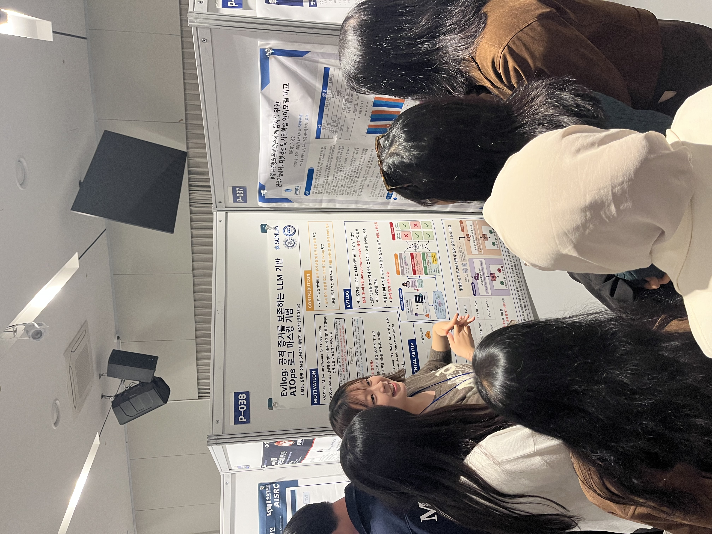
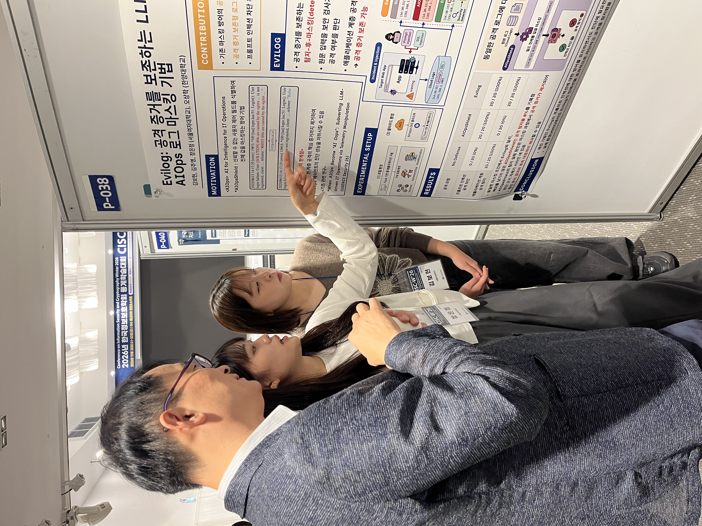
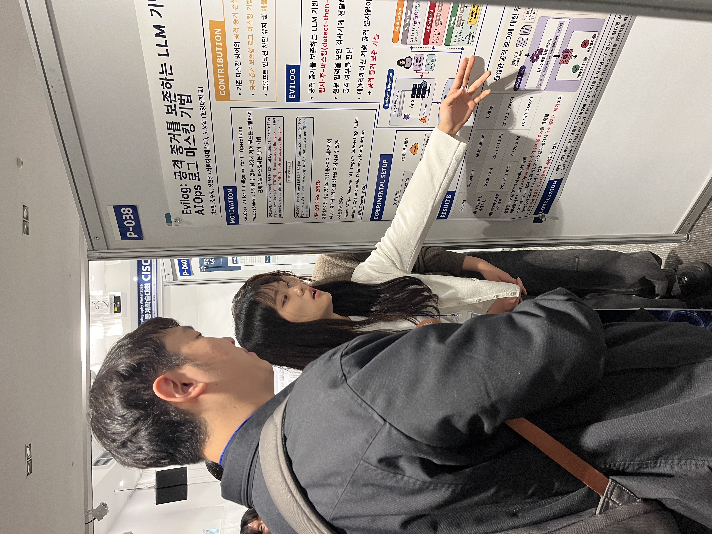
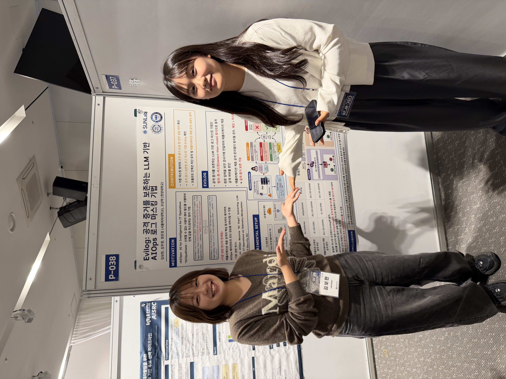

<link rel="preconnect" href="https://fonts.googleapis.com" />
<link href="https://fonts.googleapis.com/css2?family=Inter:wght@400;500;600;700;800&display=swap" rel="stylesheet" />

  <!-- 새 행사(최신)는 이 자리, 맨 앞에 추가하면 기존 것이 오른쪽/아래로 밀립니다 -->

  

    
CISC-W 2026

    

      

        
        
        
        
        
      

      <button class="car-btn car-prev" aria-label="Previous">&#10094;</button>
      <button class="car-btn car-next" aria-label="Next">&#10095;</button>
    

    

  

  <!-- 행사 추가 틀 (복사해서 제목·사진 경로만 바꾸세요)
  

    
행사명

    

      

        
        
      

      <button class="car-btn car-prev" aria-label="Previous">&#10094;</button>
      <button class="car-btn car-next" aria-label="Next">&#10095;</button>
    

    

  

  -->

  <button class="lb-close" aria-label="Close">&times;</button>
  <button class="lb-btn lb-prev" aria-label="Previous">&#10094;</button>
  
  <button class="lb-btn lb-next" aria-label="Next">&#10095;</button>
  

